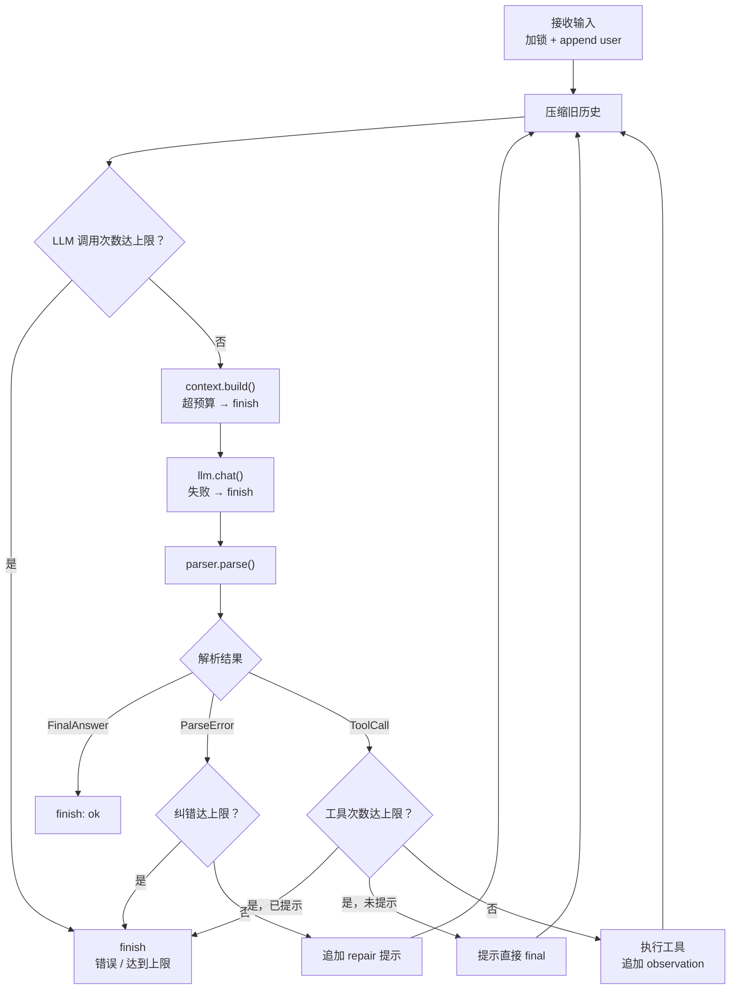

# Vibe Coding · 最小可用 Agent

一个**不依赖任何 Agent 框架**（无 LangGraph / LangChain / OpenHands 等）的最小可用 Agent Runtime。
核心循环、工具注册与调度、LLM 输出解析、Session 管理、上下文压缩、异常处理与 Trace 全部自研，底层使用 OpenAI 官方 SDK 与 Web 框架。

- 技术栈：Python 3.11+ / FastAPI / OpenAI SDK（底层 httpx）/ 原生 HTML+CSS+JS（无前端构建步骤）
- LLM：任意 OpenAI 兼容接口（`BASE_URL + API_KEY + MODEL` 配置）
- 工具协议：自定义 JSON 协议，由自研解析器提取 `thought / action / final`
- 会话：Web 端左侧 Session 列表，多个浏览器窗口可分别绑定不同 Session，互不影响
- 存储：文件系统 JSON（会话）+ JSONL（Trace），无需数据库
- 测试：pytest（单元 / 集成 / 真实 LLM + Agent 联调）

> 代码仓库：<https://github.com/tianrenheyi9/mini_agent>
> AI Prompt 与问题解决记录：[`AI_LOG.md`](./AI_LOG.md)
> 完整执行链（时序图 / 流程图 / 状态图）：[`执行链.md`](./执行链.md)

---

## 目录

1. [快速开始](#1-快速开始)
2. [需求分析与实现对照](#2-需求分析与实现对照)
3. [系统设计](#3-系统设计)
4. [Memory 的召回时机与放置方式](#4-memory-的召回时机与放置方式)
5. [上下文压缩策略](#5-上下文压缩策略)
6. [异常处理](#6-异常处理)
7. [测试方案](#7-测试方案)
8. [设计取舍与已知限制](#8-设计取舍与已知限制)
9. [AI Prompt 与问题解决记录](#9-ai-prompt-与问题解决记录)

---

## 1. 快速开始

### 1.1 环境要求

- Python 3.11+
- 一个可用的 OpenAI 兼容 LLM API Key（见 1.2）

### 1.2 安装、配置与启动

```bash
python -m venv .venv
# Windows
.venv\Scripts\activate
# macOS / Linux
source .venv/bin/activate

pip install -r requirements.txt
copy .env.example .env    # macOS/Linux: cp .env.example .env
```

编辑 `.env`：

```ini
# 任意 OpenAI 兼容接口
LLM_BASE_URL=https://api.deepseek.com/v1
LLM_API_KEY=sk-xxxxxxxxxxxxxxxx
LLM_MODEL=deepseek-chat

# 可选：访问境外 API 时设置标准代理环境变量
# OpenAI SDK 底层的 httpx 会自动读取 HTTPS_PROXY
# HTTPS_PROXY=http://127.0.0.1:7897

# Agent 运行参数
LLM_TIMEOUT_SECONDS=60
# 温度与输出上限；留空表示不发送该参数（兼容不支持这些参数的模型）
LLM_TEMPERATURE=0
LLM_MAX_TOKENS=1024
# 开启后发送 response_format={"type": "json_object"}；部分兼容服务不支持
LLM_JSON_MODE=false

TOOL_TIMEOUT_SECONDS=10       # 单个工具执行超时
TOOL_OBSERVATION_MAX_CHARS=2000  # 单条 observation 落盘/初始上限
OBSERVATION_PROMPT_CHARS=600  # 当前轮 observation 首次压缩目标
MAX_TOOL_CALLS=8              # 单轮最多执行几次工具
MAX_LLM_CALLS_PER_TURN=10     # 单轮 LLM 调用上限（含 final、纠错、额度提示）
MAX_COMPRESSION_CALLS_PER_TURN=1  # 单轮压缩调用上限
MAX_PARSE_REPAIRS=2           # 单轮协议纠错最多重试几次
CONTEXT_TOKEN_BUDGET=6000     # 估算 token 超过该值时触发压缩
TOKEN_SAFETY_FACTOR=1.2       # 估算值 × 安全系数，吸收 tokenizer 偏差
SUMMARY_MAX_TOKENS=512        # 摘要调用自身的输出上限
MAX_HISTORY_MESSAGES=40       # 未压缩历史的消息条数硬上限
KEEP_RECENT_MESSAGES=8        # 压缩后保留的最近消息条数
SUMMARY_MAX_CHARS=800         # 会话摘要最大字符数
TRACE_MAX_CHARS=2000          # Trace 中单字段最大字符数
DATA_DIR=./data               # 会话与 Trace 落盘目录
```

启动：

```bash
uvicorn app.main:app --reload --port 8000
```

打开 <http://localhost:8000>。

---

## 2. 需求分析与实现对照

### 2.1 题目拆解

| 题目要求 | 理解与落点 |
| --- | --- |
| 从零实现 Agent Runtime | 手写 `AgentLoop`：构建上下文 → 调 LLM → 解析 → 执行工具 → 回填 → 再决策。不引入任何 Agent/编排框架 |
| Step 1 接收用户输入 | `POST /api/sessions/{id}/messages` 写入用户消息，开启一个 turn |
| Step 2 判断直接回复还是调用工具 | 解析 LLM 输出：含 `final` 则直接回复；含 `action` 则进入工具调用 |
| Step 3 调用工具 | `ToolRegistry` 按名称查找工具 → Schema 校验参数 → 注入 `session_id` → 执行 → 结果作为 observation 回填 |
| Step 4 判断继续 loop 还是返回 | 一轮工具执行后重新调 LLM，直到输出 `final` 或触达 `MAX_TOOL_CALLS` |
| 至少 3 个工具，todo 必须 | 实现 4 个：`todo`、`calculator`、`search`（mock）、`weather`（mock） |
| 工具注册机制（名称、描述、参数 Schema） | `ToolRegistry.register(ToolSpec)`，`ToolSpec` 含 `name / description / parameters(JSON Schema) / handler` |
| LLM 基于 Schema 自主决策 | 每轮把工具目录（含完整 Schema）渲染进 System Prompt |
| 实现 LLM 输出解析逻辑 | `parser.py` 自研：去代码围栏、扫描平衡大括号、容错前后缀文本、校验协议、区分 `thought/action/final` |
| Session 隔离与续聊 | 每个 Session 独立 JSON 文件 + 独立内存锁；列表/切换/刷新恢复；A/B 窗口互不影响 |
| 最大轮次限制 | 分开限制：`MAX_TOOL_CALLS`（工具执行）、`MAX_LLM_CALLS_PER_TURN`（含 final/纠错/额度提示）、`MAX_COMPRESSION_CALLS_PER_TURN`（压缩） |
| 记住之前状态 / 支持追问 | 最近消息窗口 + 会话摘要 + 实时待办快照 + 当前轮工具链 |
| 纯对话追问 | 历史 user/assistant 消息在 context 中 |
| 带工具追问 | 历史 + 工具状态快照 + 工具目录持续可见 |
| 哪些信息塞入 context | 见 [第 4 节](#4-memory-的召回时机与放置方式)，逐项给出放置位置与理由 |
| context 过长基础压缩 | token 估算超阈值时，对较旧消息做 LLM 增量摘要；失败时硬截断兜底 |
| 基本异常处理 | LLM 重试、解析纠错、未知工具/参数错误自纠正、工具异常回填、超步数兜底 |
| 工具调用 trace / 执行日志 | 每次 LLM 调用、工具调用、压缩、异常都写 JSONL + 控制台日志，并在 UI 可展开查看 |
| 测试用例 | 单元 + 集成 + 真实 LLM 冒烟 + 手工双窗口验收，见 [第 7 节](#7-测试方案) |
| 真实 LLM API | 通过 OpenAI 兼容 HTTP 接口调用，无任何 mock LLM 参与线上路径 |
| README 三件套 | 运行方式、系统设计、Memory 召回时机与放置（本文）；AI 记录见 `AI_LOG.md` |

### 2.2 技术选型

| 选择 | 方案 | 理由 |
| --- | --- | --- |
| 语言 | Python 3.11 | Agent 逻辑短、可读性高；pytest 测试生态成熟 |
| Web | FastAPI + uvicorn | 自带 Pydantic 校验与 OpenAPI；静态文件托管足够本项目 UI |
| LLM 客户端 | `openai` SDK（`AsyncOpenAI`） | 官方 SDK 负责请求构造、响应类型解析、超时与重试；`base_url` 兼容任意 Provider，错误映射自行实现 |
| 前端 | 原生 HTML/CSS/JS | 免构建、免 Node 环境，面试官 `pip install` 即可跑 |
| 存储 | 每会话一个 JSON + Trace JSONL | 零依赖、可读、易调试；单机 MVP 足够 |
| Schema 校验 | 自研 JSON Schema 子集校验 | 只支持 `type/required/enum/properties/items`，足以覆盖工具参数，避免过度设计 |
| token 估算 | 中英文加权字符估算 | 避免引入 tiktoken；误差由预算留白吸收 |
| 测试 | pytest + FakeLLM | Agent 循环与异常分支可确定性测试；真实 API 单独标记 |

**明确不使用**：LangGraph、LangChain、OpenHands、AutoGen、CrewAI、官方 Agent SDK 等任何 Agent 编排/运行时框架。

### 2.3 项目结构（规划）

```text
.
├─ app/
│  ├─ main.py                 # FastAPI 入口、静态资源、异常兜底
│  ├─ config.py               # 环境变量与运行参数
│  ├─ api/
│  │  └─ routes.py            # Session / Message / Trace 接口
│  ├─ agent/
│  │  ├─ loop.py              # AgentLoop：核心循环与终止条件
│  │  ├─ parser.py            # 输出协议解析器
│  │  ├─ prompt.py            # System Prompt / 协议说明 / 工具目录渲染
│  │  ├─ context.py           # 上下文构建、token 估算、压缩
│  │  └─ llm.py               # OpenAI SDK 客户端、异常映射与超时
│  ├─ tools/
│  │  ├─ base.py              # ToolSpec / 参数校验 / 执行结果
│  │  ├─ registry.py          # 工具注册表
│  │  ├─ todo.py              # 待办（会话级状态）
│  │  ├─ calculator.py        # 安全四则运算（AST 白名单）
│  │  ├─ search.py            # Mock 搜索（固定语料）
│  │  └─ weather.py           # Mock 天气（固定规则）
│  ├─ session/
│  │  ├─ models.py            # Session / Message / 统计 / 压缩游标
│  │  ├─ manager.py           # 创建/读取/删除/会话锁
│  │  └─ store.py             # JSON 原子读写
│  ├─ trace.py                # JSONL Trace + 日志
│  └─ web/
│     ├─ index.html
│     ├─ app.js
│     └─ style.css
├─ tests/
│  ├─ agent/
│  │  ├─ test_parser.py
│  │  ├─ test_prompt.py
│  │  ├─ test_loop.py
│  │  ├─ test_context.py
│  │  └─ test_live_agent.py
│  ├─ tools/
│  │  ├─ test_schema.py
│  │  ├─ test_registry.py
│  │  ├─ test_calculator.py
│  │  ├─ test_todo.py
│  │  ├─ test_search.py
│  │  └─ test_weather.py
│  ├─ session/
│  │  ├─ test_models.py
│  │  ├─ test_store.py
│  │  └─ test_manager.py
│  ├─ llm/
│  │  ├─ fake_llm.py
│  │  └─ test_llm.py
│  ├─ test_api.py
│  ├─ test_trace.py
│  └─ test_health.py
├─ data/                      # 运行时生成（gitignore）
├─ .env.example
├─ requirements.txt
├─ AI_LOG.md                  # AI Prompt 与问题解决记录
├─ 执行链.md                  # 从用户输入到页面展示的完整执行链
└─ README.md
```

---

## 3. 系统设计

### 3.1 总体架构

```text
┌─────────────────────────────────────────────────────────────┐
│  浏览器（窗口 A / 窗口 B）                                    │
│  左侧 Session 列表 · 聊天区 · 思考/工具调用可展开 · URL 绑定会话 │
└──────────────────────────┬──────────────────────────────────┘
                           │ REST / JSON
┌──────────────────────────▼──────────────────────────────────┐
│  FastAPI                                                     │
│  routes: sessions / messages / traces / health               │
└──────────────────────────┬──────────────────────────────────┘
                           │
┌──────────────────────────▼──────────────────────────────────┐
│  Agent Runtime（自研）                                        │
│                                                              │
│  ┌─────────────┐   ┌──────────────┐   ┌──────────────────┐  │
│  │ContextBuilder│──▶│   AgentLoop  │◀─▶│   LLMClient      │  │
│  │ 摘要/历史/快照│   │ 多步循环/终止 │   │ OpenAI 兼容 HTTP │  │
│  └─────────────┘   └──────┬───────┘   └──────────────────┘  │
│         ▲                 │ parse                            │
│         │                 ▼                                  │
│  ┌──────┴──────┐   ┌──────────────┐   ┌──────────────────┐  │
│  │SessionManager│   │    Parser    │   │  ToolRegistry    │  │
│  │ 隔离/锁/落盘 │   │ thought/action│──▶│ Schema 校验/执行 │  │
│  └─────────────┘   │ /final       │   └────────┬─────────┘  │
│         │          └──────────────┘            │            │
│         │                                      ▼            │
│         │                             todo/calculator/       │
│         │                             search/weather         │
│         ▼                                                     │
│  JSON 会话文件 + JSONL Trace                                  │
└──────────────────────────────────────────────────────────────┘
```

### 3.2 一次用户请求的时序

```text
用户 ──▶ POST /messages
          │
          ├─ 1. SessionManager 加锁，加载会话
          ├─ 2. 追加 user 消息（分配 msg_id，记录 turn_id）
          ├─ 3. ContextBuilder 估算 token；超预算 → 按游标压缩旧消息
          ├─ 4. for step in range(MAX_LLM_CALLS_PER_TURN):
          │      ├─ 构建 messages；System + 当前轮超预算 → context_overflow
          │      ├─ LLMClient.chat() ──▶ 原始文本
          │      ├─ Parser.parse() ──▶ ToolCall | FinalAnswer | ParseError
          │      ├─ FinalAnswer ──▶ 落盘、返回
          │      ├─ ParseError → 协议纠错（计入 MAX_PARSE_REPAIRS）
          │      └─ ToolCall ──▶ 检查 tool_calls < MAX_TOOL_CALLS
          │          ├─ 未超限 → 执行工具 + user observation + 再次检查压缩
          │          └─ 已超限 → 提示模型直接 final；再次要工具则兜底
          ├─ 5. 触达 LLM 调用上限 → 汇总已有 observation，返回兜底回复
          └─ 6. 释放锁，更新统计，写 Trace，返回 reply + steps
```

### 3.3 Agent Loop（流程图）



节点内的“→ finish”表示该阶段失败会直接进入统一收尾；具体 `status` 见下方终止条件。两个预算互不混用：`MAX_LLM_CALLS_PER_TURN` 限制总 LLM 调用，`MAX_TOOL_CALLS` 限制实际工具执行。

**终止条件**（任一满足）：

1. 解析出 `final` → 正常返回；
2. 工具次数达到 `MAX_TOOL_CALLS` → 提示模型收尾；模型仍继续要工具则兜底；
3. 达到 `MAX_LLM_CALLS_PER_TURN`（含 final、纠错、额度提示）→ 兜底返回；
4. 达到 `MAX_PARSE_REPAIRS` → 格式异常提示；
5. LLM 重试耗尽 → 错误提示；
6. System + 当前轮超预算 → `context_overflow` 提示；
7. 客户端断开 → 取消协程（取消时也写 Trace）。

**统计口径**：`TurnStats` 分开记录 `llm_calls`、`tool_calls`、`compression_calls`、`prompt_tokens`、`completion_tokens`；Session 再累计一份，供 Trace 和 UI 展示。

### 3.4 LLM 输出协议与解析器

**协议**：模型每轮只能输出一个 JSON 对象。

工具调用：

```json
{
  "thought": "用户要查北京天气，我先调用天气工具。",
  "action": "weather",
  "input": { "city": "北京" }
}
```

最终回答：

```json
{
  "thought": "已经拿到天气和待办结果，可以汇总回复。",
  "final": "北京今天 18~26℃，多云。已帮你把“给妈妈买生日礼物”记入待办。"
}
```

**解析器职责**（`agent/parser.py`）：

1. 去除 Markdown 代码围栏（```json / ```）；
2. 若模型输出前后夹带说明文字，**扫描字符串中第一个平衡的 `{...}`**（正确处理字符串内的花括号与转义）；
3. `json.loads` 失败 → 返回 `ParseError`（不抛异常到接口层）；
4. 结构校验：
   - `action` 与 `final` 必须**恰好出现一个**；
   - `action` 必须是非空字符串，`input` 必须是对象（缺省为 `{}`）；
   - `thought` 可选，必须为字符串；
5. 返回判别联合：`ToolCall(thought, action, input)` / `FinalAnswer(thought, final)` / `ParseError(reason)`；
6. 解析失败时，把“原始输出 + 具体错误”作为协议纠错消息回填，最多 2 次。

**为什么不用原生 Function Calling**：

- 题目要求“实现 LLM 输出的解析逻辑”，自研协议能完整覆盖决策、解析、纠错、trace；
- 不依赖特定厂商的 tools 能力，任何 OpenAI 兼容模型都能跑；
- `thought` 字段让思考过程显式可观测，便于 UI 展示与调试。

#### 3.4.1 工具结果如何回填（重要）

自定义 JSON 协议**不是** OpenAI 原生 `tool_calls`。因此不能直接发送：

```python
{"role": "tool", "content": "..."}  # 缺少 tool_call_id，API 会拒绝或行为异常
```

本项目采用“**assistant 原始协议 + user observation**”：

```python
# 1. 原样保留模型刚才的决策
{
    "role": "assistant",
    "content": '{"action":"calculator","input":{"expression":"2**10"}}',
}

# 2. 用 user 角色回填工具结果
{
    "role": "user",
    "content": """[工具执行结果]
tool: calculator
status: ok
input: {"expression": "2**10"}
result: {"result": 1024}

请继续：需要更多信息就调用工具，否则输出 final。""",
}
```

失败时同样回填，但标记为 error：

```text
[工具执行结果]
tool: weather
status: error
input: {"city": ""}
error: 城市不能为空
请修正参数后重试，或向用户说明原因。
```

这样做的原因：

- 不需要伪造 `tool_call_id`；
- 模型能看到“自己刚才做了什么”和“工具返回了什么”，支持多步串联；
- 与自定义协议完全一致，不混用两套调用机制；
- `[工具执行结果]` 是显式标记，避免模型把 observation 误认为新的用户需求。

**不要同时使用 `role="tool"` 和自定义协议**：那会形成一套不完整的原生工具调用消息，容易导致 API 报错或模型混淆。

### 3.5 工具系统

**注册机制**：

```python
@dataclass(frozen=True)
class ToolSpec:
    name: str                 # 唯一名称，LLM 调用时使用
    description: str          # 何时使用、返回什么
    parameters: dict          # JSON Schema 子集
    handler: Callable[..., Awaitable[Any]]
```

- `ToolRegistry.register(spec)`：名称重复直接报错（启动期暴露问题）；
- `ToolRegistry.tools()`：返回全部 ToolSpec，交给 `prompt.py` 渲染工具目录；
- `ToolRegistry.execute(name, raw_input, context)`：
  1. 查找工具（未知 → 返回可用工具列表）；
  2. 用自研 `validate_parameters(schema, raw_input)` 校验 `required/type/enum/properties/items`；
  3. Runtime 注入 `ToolContext`（含 `session_id` 与 `todos`，模型看不到这些内部字段）；
  4. 执行并统一包装为 `ToolResult(tool, ok, data, error, duration_ms)`；
  5. 异常捕获，返回可读错误，完整堆栈只进日志/Trace。

**四个工具**：

| 工具 | 作用 | 参数 Schema（摘要） | 说明 |
| --- | --- | --- | --- |
| `todo` | 会话级待办管理 | `action: add/list/complete/delete/clear`；`content?`、`id?` | **必需**。状态存 Session，不靠模型记忆 |
| `calculator` | 安全算术计算 | `expression: string` | `ast` 白名单解析，禁止 `eval`、变量、函数调用、属性访问 |
| `search` | 文档/网页检索（Mock） | `query: string`；`limit?: int(1~5)` | 固定语料关键词打分，结果确定，便于测试 |
| `weather` | 天气查询（Mock） | `city: string`；`date?: string` | 固定城市表 + 日期哈希生成稳定天气 |

**待办数据流**：

```text
todo(add) ──▶ 写入 session.todos（落盘）
                     │
下一次构建 context ──▶ 渲染为 System Prompt 的“当前待办快照”
                     │
UI 会话侧栏/详情 ◀── 直接读取 session.todos
```

即：待办既通过工具修改，又通过**每轮实时快照**进入上下文。模型不需要“记住”待办，避免状态漂移。

### 3.6 Session 管理

**数据模型**（`data/sessions/<session_id>.json`）：

```json
{
  "id": "s_01J...",
  "title": "北京天气与待办",
  "created_at": "2026-10-18T12:00:00+08:00",
  "updated_at": "2026-10-18T12:03:00+08:00",
  "summary": "用户询问北京天气并把买礼物加入待办……",
  "summary_until_msg_id": "m_6",
  "next_msg_seq": 7,
  "stats": {
    "llm_calls": 3,
    "tool_calls": 2,
    "compression_calls": 1,
    "prompt_tokens": 1832,
    "completion_tokens": 210,
    "compression_prompt_tokens": 620,
    "compression_completion_tokens": 120
  },
  "todos": [
    { "id": "t_1", "content": "给妈妈买生日礼物", "done": false, "created_at": "..." }
  ],
  "messages": [
    { "msg_id": "m_1", "role": "user", "content": "...", "turn_id": "u_1", "created_at": "..." },
    {
      "msg_id": "m_2",
      "role": "assistant",
      "kind": "tool_call",
      "content": "{\"action\":\"weather\",\"input\":{\"city\":\"北京\"}}",
      "thought": "先查天气",
      "turn_id": "u_1",
      "created_at": "..."
    },
    {
      "msg_id": "m_3",
      "role": "user",
      "kind": "tool_observation",
      "tool": "weather",
      "status": "ok",
      "content": "[工具执行结果] tool=weather status=ok ...",
      "turn_id": "u_1",
      "created_at": "..."
    },
    {
      "msg_id": "m_4",
      "role": "assistant",
      "kind": "final",
      "content": "北京今天 18~26℃，多云。",
      "thought": "信息已足够",
      "turn_id": "u_1",
      "created_at": "..."
    }
  ]
}
```

**三个关键字段**：

| 字段 | 作用 |
| --- | --- |
| `msg_id` | 会话内单调递增（`m_1`、`m_2`…），永不复用；压缩游标和 UI 定位都依赖它 |
| `next_msg_seq` | 下一条消息的序号；落盘保存，避免重启后 id 回退 |
| `summary_until_msg_id` | 摘要已经覆盖到的最后一条消息；压缩时只处理它之后的新消息，避免重复摘要 |
| `stats` | 累计统计 LLM 调用、工具调用、压缩次数与 token，和 `MAX_TOOL_CALLS` 等限制分开 |

**消息 `kind`**：`user` / `final` / `tool_call` / `tool_observation` / `repair`。
历史轮次进入上下文时只取 `user` 原文与 `final`；`tool_call`、`tool_observation`、`repair` 供当前轮推理、UI 和 Trace 使用。

**隔离与并发**：

- 会话 ID 使用 `s_` + 随机 ULID/UUID，文件名与 ID 一致；
- 每个会话一把 `asyncio.Lock`，同一会话请求串行，不同会话可并行；
- 写入采用“临时文件 + `os.replace`”原子替换，避免半写文件；
- 列表接口只读取元数据（启动时可用轻量索引），按 `updated_at` 倒序；
- URL Hash `#/s/<id>` 绑定会话：两个浏览器窗口天然是两条独立会话，刷新可恢复。

**消息不删除**：压缩只推进 `summary_until_msg_id`，不改写历史消息；UI 与 Trace 仍能看到完整过程。

**首条消息生成标题**：取首条用户消息前 20 个字符作为标题（失败/为空则“新会话”），无需额外 LLM 调用。

### 3.7 Web 交互

- 左侧 Session 列表：标题、消息数、未完成待办数、更新时间、新建/删除；当前会话高亮；
- 右侧聊天区：用户消息与 Agent 回复分栏展示；回复支持段落、列表、粗体、行内代码的**安全轻量渲染**；
- assistant 消息下可展开「思考与工具调用」时间线，显示每一步的工具名、参数、状态、结果；
- 工具时间线从 Session 中持久化的 `tool_call` / `tool_observation` 重建，因此**刷新后仍然存在**，不只依赖当次 POST 响应；
- URL Hash `#/s/<session_id>` 绑定会话：刷新恢复、两个浏览器窗口天然是两条独立 Session；
- 输入框：Enter 发送、Shift+Enter 换行；发送中显示“思考中…”并禁用按钮；
- **发送状态按 Session 独立维护**：A 会话执行中，切到 B 会话仍可发送；侧栏会在 A 上显示“思考中…”；
- **输入草稿按 Session 独立保存**：切走再切回会恢复各自草稿；发送失败也会恢复内容；
- 422/网络错误以可读摘要展示，不会把超长校验输入铺满页面；
- 侧栏提供 **↗ 新窗口**：新建一个独立 Session 并在新窗口打开；同一个 `#/s/<id>` 的两个窗口共享会话，按设计串行；
- 会话列表通过 `BroadcastChannel` 跨窗口同步；
- 顶部/侧栏展示模型连接状态；错误以条幅展示；
- 移动端侧栏自动收起为抽屉；
- 无构建步骤：FastAPI `StaticFiles` 直接托管 `app/web/`（原生 HTML/CSS/JS）。

### 3.8 端到端验证

真实模型 `qwen3.8-max` 下已在浏览器中验证：

1. 新建会话，发送“计算 2 的 10 次方，然后记一条待办”；
2. Agent 实际调用 `calculator` 与 `todo`，回复包含 `1024`，待办数为 1；
3. 展开「思考与工具调用」，能看到 2 步工具记录；
4. 刷新页面，URL Hash 恢复会话，完整消息与工具时间线仍在；
5. 新建第二个会话做纯对话，两个会话的消息数与待办互不影响；
6. 切回第一个会话，历史与待办正确恢复；
7. 在会话 A 发送长任务，立即切到会话 B：B 的发送按钮可用，B 正常返回；此时侧栏 A 仍显示“思考中…”；
8. A 完成后，其回复、历史与待办正确落盘；
9. 点侧栏「↗ 新窗口」会创建一个新 Session 并在新窗口打开，两个窗口的 `#/s/<id>` 不同，可并行对话；
10. 在会话 A 输入草稿后切到 B，B 的输入框为空；切回 A，草稿恢复；
11. 输入超过 10000 字发送，显示可读的 422 错误，草稿保留；
12. 让 Agent 完成不存在的待办 `t_999`，工具时间线显示 `error` 徽标和错误 observation，Agent 能向用户解释。

---

## 4. Memory 的召回时机与放置方式

本项目的 “memory” 指**会话内记忆**。Session 是记忆的隔离边界：跨 Session 不共享任何上下文或状态（符合题目“窗口 1 / 窗口 2 互不影响”）。

### 4.1 信息放置总表

| 信息 | 存储位置 | 进入上下文的位置 | 召回时机 | 为什么放这里 |
| --- | --- | --- | --- | --- |
| System 角色与输出协议 | `prompt.py` 常量 | System Prompt 开头 | 每次 LLM 调用 | 协议必须最高优先级、每轮可见 |
| 工具目录（名称/描述/Schema） | `ToolRegistry` | System Prompt | 每次 LLM 调用 | 让模型基于真实 Schema 决策，避免臆造参数 |
| 会话摘要 | `session.summary` | System Prompt | 每轮构建上下文时 | 压缩后的长期事实，放在 system 中不影响消息配对 |
| 摘要游标 | `session.summary_until_msg_id` | 不进入 Prompt | 每次压缩 | 只摘要游标之后的新消息，防止重复摘要 |
| 运行统计 | `session.stats` / `TurnStats` | Trace / TurnResult | 每轮结束 | LLM、工具、压缩次数与 token 分开统计 |
| 待办快照 | `session.todos` | System Prompt | 每轮**实时生成** | 状态类事实以存储为准，避免模型“记忆漂移” |
| 当前时间 | 运行时 | System Prompt | 每轮 | 支持“今天/本周”等相对时间 |
| 最近 N 条已完成对话 | `session.messages` | messages 数组尾部 | 每轮 | 保证追问连贯，控制 token |
| 当前轮的 user 输入 | `session.messages` | messages 数组 | 当前轮 | 直接任务输入 |
| 当前轮的 assistant 工具调用 | `session.messages` | messages 数组 | 同一轮内后续步骤 | 多步工具串联必需（模型要知道上一步调了什么） |
| 当前轮的工具 observation | `session.messages` | messages 数组（user 角色 + `[工具执行结果]` 标记） | 同一轮内后续步骤 | 工具结果是本轮推理依据；不使用缺少 `tool_call_id` 的 `role="tool"` |
| **历史轮的中间工具调用/结果** | `session.messages`（供 UI/Trace） | **默认不进入上下文** | 不召回 | final 已沉淀结论；原始结果重复注入会快速膨胀 |
| **历史轮的 thought** | `session.messages`（供 UI/Trace） | **不进入上下文** | 不召回 | 思考过程只对当轮决策有效，历史 thought 会干扰后续 |
| 完整 Trace | `data/traces/*.jsonl` | 不进入上下文 | 仅排障 | 可观测性数据，不属于对话记忆 |

### 4.2 每轮上下文的最终形态

```text
messages = [
  { role: "system", content:
      [角色与行为约束]
    + [输出协议：只输出一个 JSON，action/final 二选一]
    + [工具目录：4 个工具的 name/description/JSON Schema]
    + [会话摘要：≤ SUMMARY_MAX_CHARS]
    + [当前待办快照：未完成在前，含 id]
    + [当前时间]
  },
  ...最近 K 条已完成轮次（仅 user 原文 + assistant final）,
  { role: "user", content: 当前输入 },
  ...当前轮中间步骤（assistant 原始协议 + user observation）,
]
```

工具 observation 的放置方式很关键：它使用 **user 角色**并带 `[工具执行结果]` 标记，而不是 `role="tool"`。原因见 [4.4.1](#441-工具结果如何回填重要)。

### 4.3 追问为什么能工作

- **纯对话追问**（“那上海呢？”）：
  最近消息窗口里保留上一轮的 `user: 北京天气…` 与 `assistant: 北京今天…`，模型可解析指代，直接输出 `final` 或再次调用工具。
- **带工具追问**（“刚才记的待办是什么？”）：
  即使历史消息被压缩，`session.todos` 仍会以快照形式进入 System Prompt；模型看到待办列表后调用 `todo(list)` 或直接回答。
- **跨轮状态**（“把刚才那条标记完成”）：
  待办 id 在快照中持续可见，模型可用 `todo(complete, id=...)` 精确操作。

### 4.4 召回时机一句话总结

> **每轮请求开始时召回一次**：从磁盘加载会话 → 估算上下文 → 必要时压缩 → 将「摘要 + 待办快照 + 工具目录 + 最近对话 + 当前轮」组装为 prompt。
> **轮内每次 LLM 调用重新组装一次**：追加当前轮新增的 assistant 工具调用与 observation。
> **不做事后召回**：没有向量库、没有跨会话检索；Session 内状态由结构化存储保证，而不是让模型“回忆”。

---

## 5. 上下文压缩策略

### 5.1 触发条件

满足任一即触发（在追加当前用户消息之后、进入循环之前）：

- 估算 token 超过 `CONTEXT_TOKEN_BUDGET`（默认 6000）；
- 已完成消息条数超过安全上限（默认 40 条）。

token 估算采用中英文加权：

```text
raw = 中文字符数 × 1.0 + 其他字符数 ÷ 4 + 每条消息固定开销 4
estimate = ceil(raw × TOKEN_SAFETY_FACTOR)
```

`TOKEN_SAFETY_FACTOR`（默认 1.2）用于吸收不同厂商 tokenizer 的偏差。
估算只用于触发阈值，实际精度不影响正确性；API 返回的 `usage.prompt_tokens` 会用于统计对账。

### 5.2 压缩算法（基础版）

```text
保留：最近 KEEP_RECENT_MESSAGES（默认 8）条已完成消息
摘要范围：summary_until_msg_id 之后、最近窗口之前的消息
摘要输入：旧摘要 + 这批新消息（user 原文、assistant final、工具调用摘要）
摘要输出：≤ SUMMARY_MAX_CHARS 的结构化文本：
  1. 用户目标与偏好
  2. 已确认的关键事实/数字
  3. 已完成的工具操作及其结论
  4. 当前待办与未决问题
写回：session.summary
      session.summary_until_msg_id = 最后一条被摘要消息的 msg_id
      session.stats.compression_calls += 1
消息不删除（供 UI/Trace），但游标之前的消息不再直接进入上下文
```

**增量摘要有两个前提**：

1. `new_summary = summarize(old_summary + new_dropped_messages)`，而不是从零重算；
2. **游标只前进不后退**。第二次压缩时，`m_1..m_12` 已经被摘要覆盖，不会再被送进摘要器，避免重复消耗 token 和摘要失真。

**游标之后没有新消息、但仍然超预算**怎么办？
说明最近窗口本身太大（例如单条工具结果极长）。此时降级为对最近窗口做字符截断，或临时缩小 `KEEP_RECENT_MESSAGES`，并记录 `event=compress, fallback=truncate`。

**分类统计**：

- `compression_calls`：压缩 LLM 调用次数（受 `MAX_COMPRESSION_CALLS_PER_TURN` 限制）；
- `compression_prompt_tokens` / `compression_completion_tokens`：压缩自身消耗；
- 与主循环的 `llm_calls`、`tool_calls` 分开记录，不混为一个 `MAX_TOOL_CALLS`。

**兜底**：

- 摘要 LLM 调用失败/超时 → 不重试超过 1 次，直接使用“上一版摘要 + 被淘汰消息中的最后 2 条 user/assistant 原文”作为新摘要；
- 摘要仍超长 → 按字符硬截断并加 `…`，保证 prompt 不超预算；
- 压缩过程写 Trace（`event=compress`），记录压缩前后估算 token、淘汰条数；
- **硬截断按完整轮次删除历史**，避免留下没有 user 的 final；
- **当前轮 observation 分级压缩**：从最旧的工具结果开始，依次尝试 600/300/120/40 字符，保留 `tool/status` 头部；仍放不下则替换成“已省略”，最新结果尽量保留完整；
- 只有 System + 当前用户消息本身仍超预算时，才抛 `ContextBudgetExceeded`，Agent 返回 `context_overflow`；
- 每次工具执行后再次检查压缩，避免长工具结果把上下文撑大。

### 5.3 不做的复杂压缩

按题目要求，不实现：向量检索记忆、分层摘要树、重要度打分、工具结果语义去重。README 中将其列为后续可扩展方向。

---

## 6. 异常处理

| 场景 | 处理 | 用户感知 |
| --- | --- | --- |
| LLM 网络错误 / 超时 / 5xx / 429 | 由 OpenAI SDK 自动指数退避重试（`max_retries=2`），仍失败则中止本轮 | “模型服务暂时不可用，请稍后重试。” |
| LLM 4xx（鉴权/参数） | 不重试，记录错误码 | “模型配置有误：<原因>” |
| 输出不是合法 JSON | 回填协议纠错消息，最多 2 次 | 正常回复或格式异常提示 |
| `action` 与 `final` 同时/都缺失 | 视为协议错误，同上 | 同上 |
| 未知工具 | 把“可用工具：…”作为 observation 回填 | 模型自我纠正 |
| 参数 Schema 校验失败 | 把具体字段错误回填 | 模型自我纠正 |
| 工具执行抛异常 | 捕获并回填“工具执行失败：<安全信息>”，堆栈只进 Trace | 模型解释或改用其他方式 |
| 工具超时 | 每个工具 10s 超时，视同执行失败 | 同上 |
| 工具次数达到 `MAX_TOOL_CALLS` | 提示模型直接输出 final；仍继续要工具则终止循环 | 阶段性结果 |
| LLM 调用达到 `MAX_LLM_CALLS_PER_TURN` | 终止循环，返回阶段性结果 | 明确告知调用上限 |
| System + 当前轮超过上下文预算 | 先分级压缩当前轮 observation；仍超限才返回 `context_overflow` | “本轮上下文超出预算（可能来自较长的工具结果），请重试或缩小任务范围。” |
| Trace 写盘/读取失败 | 只记录日志，不中断 Agent | 正常回复 |
| 协议纠错达到 `MAX_PARSE_REPAIRS` | 停止重试，返回格式异常提示 | “模型输出格式异常，请重试。” |
| 压缩达到 `MAX_COMPRESSION_CALLS_PER_TURN` | 跳过后续压缩，降级为硬截断 | 对话继续 |
| calculator 嵌套乘方 | 执行 `**` 前按预估位宽拒绝，不先算出大整数 | 模型看到“计算结果过大”并调整 |
| 会话不存在 / ID 非法 | API 返回 404/400 | UI 提示并回到会话列表 |
| 同一会话并发请求 | 会话锁串行化 | 稍候自动完成 |
| 磁盘写失败 | 返回 500，日志记录；内存状态不提交 | 提示重试 |
| 压缩失败 | 降级为硬截断 | 对话继续 |
| 客户端断开 | 取消异步任务，释放锁 | — |

所有异常都不向模型泄漏堆栈、文件路径或密钥；错误信息经过白名单化处理。

---

## 7. 测试方案

### 7.1 分层

| 层级 | 对象 | 方式 |
| --- | --- | --- |
| 单元 | Parser、Schema 校验、Calculator 安全、Search/Weather 确定性 | 纯函数测试 |
| 组件 | AgentLoop + ToolRegistry | 注入 `FakeLLM`，按脚本返回预设 JSON，断言调用序列 |
| 集成 | SessionManager + 存储 + ContextBuilder | 临时目录，落盘/重载/隔离/压缩 |
| API | FastAPI 路由 | `TestClient` |
| 真实 | 真实 OpenAI 兼容接口 | `pytest -m live`，无 Key 自动跳过 |
| 手工 | 双窗口交互 | 手工打开两个浏览器窗口验证 |
| 端到端 | 浏览器 + 真实模型 | 已按 3.8 节在 UI 中实际验证 calculator + todo、刷新恢复与双会话隔离 |

### 7.2 核心测试用例

**解析器**
- 纯 JSON / ```json 围栏 / 前后有解释文字；
- 字符串内含 `{}`、转义引号、嵌套对象；
- 缺少 `action` 与 `final`、两者同时存在、`input` 非对象、非 JSON；
- 超长输出中定位第一个完整对象。

**工具**
- 重复注册报错；目录渲染包含全部 4 个工具；
- `calculator`：优先级、括号、负数、除零、`__import__`/函数调用/属性访问被拒绝；
- `calculator` 嵌套乘方：`(2**100)**100` 在计算前被预估位宽拦截；
- `todo`：add → list → complete → delete → clear；未知 id 报错；跨请求持久化；
- `search`：命中固定语料、无结果、limit 边界；
- `weather`：同城同日结果稳定、未知城市降级。

**循环**
- 直接回复；单工具；多工具串联；
- **observation 消息格式**：assistant 原始协议 + user 角色 `[工具执行结果]`，不含 `role="tool"`；
- 未知工具 → 自我纠正；参数错误 → 自我纠正；
- 非法 JSON → 纠错重试；达到 `MAX_PARSE_REPAIRS` → 兜底；
- 工具抛异常 → observation 回填后继续循环；
- 工具次数达到 `MAX_TOOL_CALLS` 后仍保留一次 final 机会；模型无视提示再次要工具才兜底；
- 达到 `MAX_LLM_CALLS_PER_TURN` → 终止且回复完整；
- 不同 Session 可并行；前端 pending 状态按 Session 隔离；
- 上下文超预算 → 先分级压缩当前轮 observation；仍超限才 `context_overflow`；
- `TurnStats` 分别记录 llm_calls / tool_calls / compression_calls / tokens；
- LLM 超时/5xx → SDK 重试 → 最终失败提示。

**Session**
- 两个 Session 交错执行，消息与待办完全隔离；
- **不同 Session 的 LLM 调用并行执行**；同一 Session 仍由锁串行；
- `msg_id` 单调递增、不复用；
- `summary_until_msg_id` 持久化并在重载后保留；
- `stats` 累计值与 turn 增量一致；
- 落盘后新建 Manager 重载，历史/摘要/待办一致；
- 删除会话同时删除 Trace；
- 并发请求同一 Session 串行（锁生效）。

**Context**
- 未超预算不压缩；
- 超预算触发摘要，摘要进入 System Prompt，最近 K 条原文保留；
- `build()` 只把 user / final 放入历史窗口，历史 thought 与工具结果不进入上下文；
- 最近窗口从 final 开始时，自动补回配对的 user 消息；
- **硬截断按完整轮次删除**，不破坏 User/Assistant 配对；
- **当前轮 observation 超长时先分级压缩**，保留 tool/status 头部，最新结果尽量完整；
- 只有 System + 当前用户消息本身仍超预算，才抛 `ContextBudgetExceeded`；
- **游标只前进**：第二次压缩不会重复摘要 `summary_until_msg_id` 之前的消息；
- 摘要合并旧摘要（增量）；
- 摘要失败降级截断；
- 压缩单独累计 `compression_calls` 与压缩 token；
- 摘要调用显式 `json_mode=False`。

**Trace**
- JSONL 追加、字段截断、最近 N 条读取；
- 损坏行跳过；
- 写盘/读取失败只记日志，不影响 Agent 结果。

**API**
- 创建/列表/详情/删除；
- 发消息返回 reply + steps + stats；
- 不存在的 session → 404；空消息 → 422。

**真实 LLM**
- `tests/agent/test_live_agent.py` 通过 `AgentLoop.run_turn()` 发送“计算 2 的 10 次方并记一条待办”；
- 断言 calculator 与 todo 都实际执行、最终回复包含 `1024`、todo 落盘；
- `tests/agent/test_live_scenario.py` 用 9 轮会议筹备故事覆盖真实多轮：weather/search/calculator/todo、改需求、纯对话召回、1/0 工具错误、压缩、双会话并发和磁盘重载；核心不变量断言，模型行为差异打印为诊断项；
- **仅调用 `LLMClient.chat()` 回复“你好”不算 Agent 工具调用验收**；live 测试必须走完整循环。

### 7.3 FakeLLM 设计

- 实现与 `LLMClient` 相同的 `chat(messages) -> str` 接口；
- 按顺序返回预设响应，并记录收到的 messages，供断言上下文内容；
- 支持注入异常（超时、5xx）与延迟；
- 使 Agent 循环、压缩、异常路径全部可在无网络、无 API Key 的情况下确定性测试。

### 7.4 Web UI 手工验收清单

| 项目 | 状态 | 说明 |
| --- | --- | --- |
| 健康状态与模型名 | ✅ | 侧栏显示“模型已连接 · qwen3.8-max” |
| 新建 / 切换 / 删除会话 | ✅ | 删除当前会话后回到未选择状态 |
| 纯对话 / 单工具 / 多工具 | ✅ | 真实模型调用 calculator + todo |
| 思考与工具时间线 | ✅ | 展开后显示工具名、参数、状态、结果 |
| 刷新恢复 | ✅ | `#/s/<id>` 恢复消息与工具时间线 |
| 双 Session 隔离 | ✅ | 消息、待办、标题互不影响 |
| A 思考中 B 可发送 | ✅ | B 发送按钮可用，A 侧栏显示“思考中…” |
| 跨会话草稿隔离 | ✅ | A 草稿不会出现在 B，切回 A 恢复 |
| 空输入 / 建议按钮 | ✅ | 空输入禁用；建议按钮只填充不自动发送 |
| 超长输入 422 | ✅ | 显示可读错误摘要，草稿保留 |
| 工具错误时间线 | ✅ | `t_999` 不存在时显示 `error` 徽标与 observation |
| 已删除 Session 的旧 Hash | ✅ | 清空 Hash 并提示“会话不存在或已被删除” |
| 安全 Markdown 渲染 | ✅ | 段落/列表/粗体/行内代码，全部 DOM + textContent |
| ↗ 新窗口按钮 | ✅ | 创建新 Session 并打开独立 Hash（URL 已验证） |
| 移动端抽屉（最新版本） | ⬜ | 建议再手工确认一次侧栏、新建按钮、输入框 |
| 两个真实浏览器窗口 + 列表同步 | ⬜ | 需开两个 tab 验证 `BroadcastChannel` |
| 服务重启后的持久化 | ⬜ | 重启 uvicorn 后刷新，检查 Session/Trace |
| Shift + Enter 换行 | ⬜ | 手工输入多行任务 |
| 同 Session 双窗口串行 | ⬜ | 预期行为：同一 Session 会等待，不是并行 |
| 模型未配置 / 网络断开 | ⬜ | 临时使用空 Key 或断网验证错误提示 |

> 标 ✅ 的项目已在真实浏览器 + 真实模型下验证；标 ⬜ 的项目不影响当前演示，但建议提交前补一次手工确认。

---

## 8. 设计取舍与已知限制

| 取舍 | 决定 | 原因 / 代价 |
| --- | --- | --- |
| 工具协议 | 自研 JSON 协议 | 满足“自行解析”要求、可移植；代价是比原生 tool calling 多一层纠错 |
| 工具结果回填 | assistant 原始协议 + user observation | 不伪造 `tool_call_id`；代价是模型需要通过 `[工具执行结果]` 文本标记理解 observation |
| 循环预算 | 工具次数、LLM 调用、压缩、纠错分别限制 | `MAX_TOOL_CALLS` 只管工具执行；`MAX_LLM_CALLS_PER_TURN` 含 final/纠错；代价是配置项更多 |
| 上下文硬边界 | 历史按完整轮次删除；当前轮 observation 分级压缩 | 不破坏 User/Final 配对，也不把工具输出过长归咎于用户；代价是旧工具结果会被截断 |
| Trace 故障 | 写盘/读取失败只记日志 | 可观测性数据不能影响业务；代价是 Trace 可能缺失 |
| LLM 客户端 | 懒加载并复用，shutdown 时关闭 | 复用连接池；代价是需要显式生命周期管理 |
| 压缩游标 | `summary_until_msg_id` 只前进 | 防止重复摘要和 token 浪费；代价是 Session 模型多一个字段 |
| 流式输出 | 暂不实现 | MVP 以完整轮次返回；UI 显示步骤时间线。后续可改 SSE 推送 step 事件 |
| 存储 | JSON 文件 | 零依赖、可读；不适合大规模并发/多实例，后续可换 SQLite/Postgres |
| 记忆 | 仅会话内 | 题目要求窗口隔离；跨会话检索会引入隐私与串扰问题，列为扩展 |
| 压缩 | 单层增量摘要 | 满足“基础压缩”；不做向量召回与摘要树 |
| token 估算 | 字符加权 + 20% 安全系数 | 免依赖 tiktoken；跨 Provider 更稳，usage.prompt_tokens 用于对账 |
| 认证 | 无登录 | 单机演示；生产需加用户体系与 Session 归属校验 |
| 工具 mock | search / weather 固定数据 | 保证测试确定性；真实接入只需替换 handler |

**明确不做的**：多 Agent 协作、MCP、长期向量记忆、流式 token、多用户权限、分布式部署。

---

## 9. AI Prompt 与问题解决记录

完整记录见 [`AI_LOG.md`](./AI_LOG.md)，内容包括：

1. 需求拆解与选型讨论（技术栈、Provider、协议、UI 形态的对比与结论）；
2. 关键 Prompt：System Prompt 全文、协议纠错 Prompt、压缩摘要 Prompt；
3. 开发过程中的问题与解决：解析器容错、上下文膨胀、压缩后指代丢失、Session 并发写入、mock 工具确定性等；
4. 真实 LLM 联调记录：模型不遵守 JSON 协议时的纠错策略与迭代。

---

## 附：提交物清单

- [x] 源码（自研 Agent Runtime，无 Agent 框架依赖）
- [x] `README.md`：运行方式、系统设计、Memory 召回时机与放置方式
- [x] `AI_LOG.md`：AI Prompt 与问题解决记录
- [x] 测试用例与运行结果：`pytest -q` → 200 passed, 3 deselected；`pytest -m live -q` → 3 passed；浏览器端到端已复验
- [x] GitHub 仓库链接：<https://github.com/tianrenheyi9/mini_agent>
