# 执行链：从用户输入到页面展示

> 示例任务：**“计算 2 的 10 次方，然后记一条待办：周五前提交周报。”**
>
> 代码基线：`main` 分支，提交 `bcb0ec2`。
>
> 本文按“浏览器 → API → Agent Runtime → LLM / 工具 → 存储 → 响应 → UI”的顺序，把一次完整请求拆开。图中出现的所有组件都是项目内自研或原生实现，没有使用 Agent 编排框架。

---

## 目录

1. [全景架构](#1-全景架构)
2. [启动装配](#2-启动装配)
3. [一次请求的总时序](#3-一次请求的总时序)
4. [浏览器侧：输入与 pending](#4-浏览器侧输入与-pending)
5. [API 层](#5-api-层)
6. [AgentLoop 主流程图](#6-agentloop-主流程图)
7. [上下文构建](#7-上下文构建)
8. [压缩流程](#8-压缩流程)
9. [LLM 调用](#9-llm-调用)
10. [协议解析](#10-协议解析)
11. [工具执行](#11-工具执行)
12. [消息演化图](#12-消息演化图)
13. [持久化与 Trace](#13-持久化与-trace)
14. [返回与页面渲染](#14-返回与页面渲染)
15. [异常与终止分支](#15-异常与终止分支)
16. [并发模型](#16-并发模型)
17. [真实运行示例](#17-真实运行示例)
18. [关键文件与函数索引](#18-关键文件与函数索引)

---

## 1. 全景架构

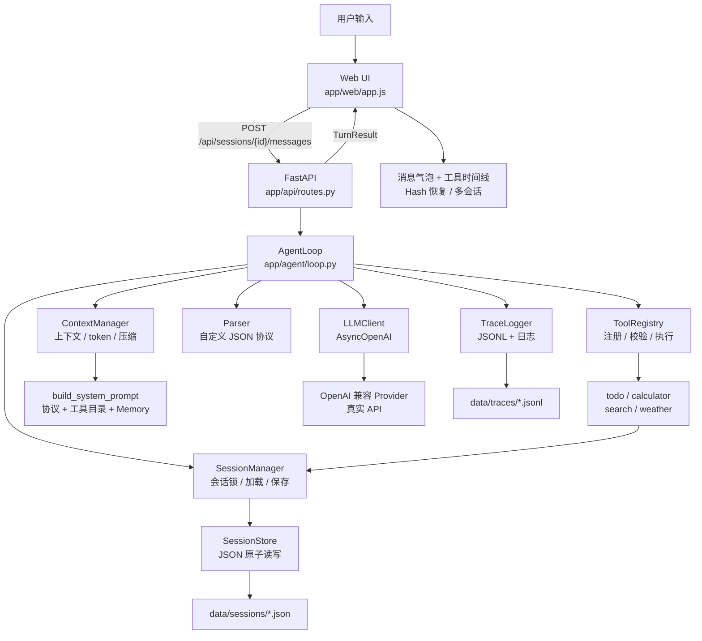

### 分层视图

```text
┌─────────────────────────────────────────────────────────────┐
│ 浏览器                                                       │
│  Session 侧栏 · 聊天区 · 思考/工具时间线 · 输入草稿 · pending │
└──────────────────────────┬──────────────────────────────────┘
                           │ HTTP JSON
┌──────────────────────────▼──────────────────────────────────┐
│ FastAPI                                                     │
│  /api/sessions · /messages · /traces · /health              │
└──────────────────────────┬──────────────────────────────────┘
                           │
┌──────────────────────────▼──────────────────────────────────┐
│ Agent Runtime（自研）                                        │
│                                                             │
│  AgentLoop                                                  │
│    ├─ ContextManager  上下文 / token / 压缩                  │
│    ├─ LLMClient       OpenAI SDK                            │
│    ├─ Parser          thought / action / final              │
│    ├─ ToolRegistry    Schema 校验 / 超时 / 异常包装          │
│    ├─ SessionManager  每会话锁 / 原子保存                    │
│    └─ TraceLogger     JSONL 事件                            │
│                                                             │
│  工具：todo · calculator · search · weather                  │
└──────────────────────────┬──────────────────────────────────┘
                           │
┌──────────────────────────▼──────────────────────────────────┐
│ 存储                                                         │
│ data/sessions/<session_id>.json   会话 + 消息 + 待办 + 统计  │
│ data/traces/<session_id>.jsonl    LLM / 工具 / 压缩事件      │
└─────────────────────────────────────────────────────────────┘
```

---

## 2. 启动装配

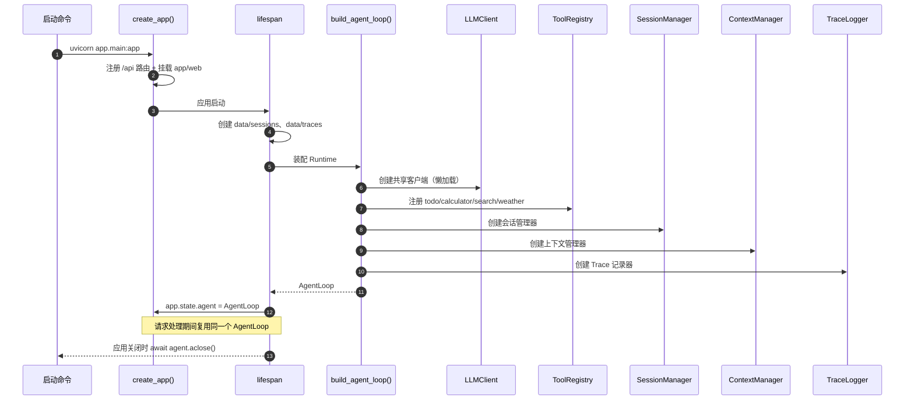

关键点：

- `AgentLoop` 是无状态编排器；每个 Session 的状态都在 `Session` 对象和磁盘中。
- `LLMClient` 懒加载并复用 `AsyncOpenAI`，复用连接池。
- 不同 Session 使用不同的 `asyncio.Lock`，可并行；同一 Session 串行。
- `create_app(agent=...)` 允许测试注入 FakeLLM 装配的 AgentLoop。

---

## 3. 一次请求的总时序

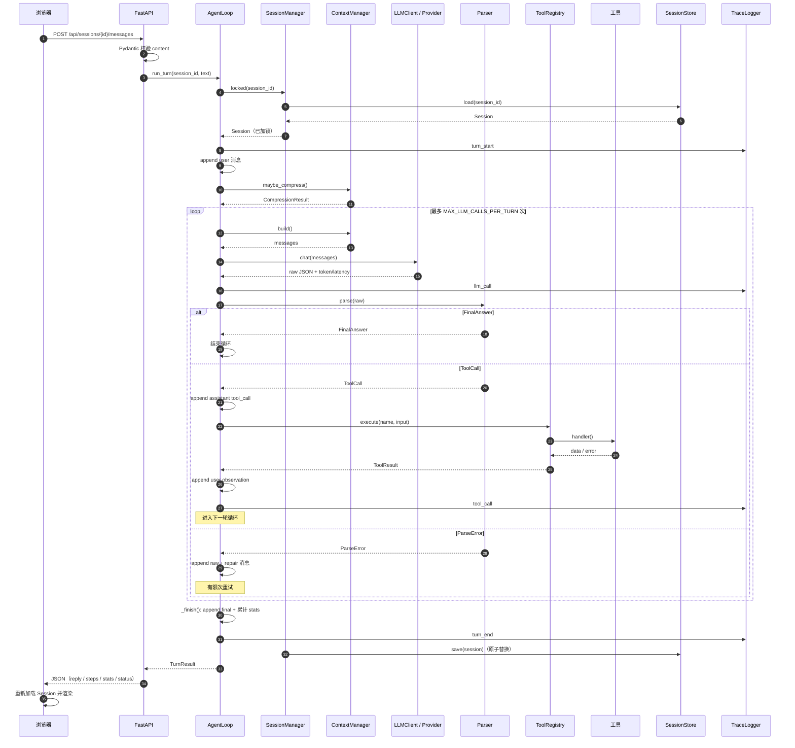

---

## 4. 浏览器侧：输入与 pending

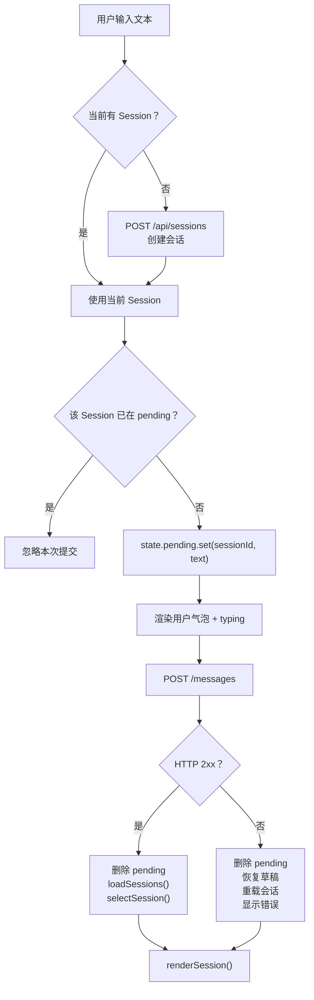

状态对象：

```js
state = {
  sessions: [...],          // 侧栏元数据
  currentId: "s_...",       // 当前会话
  current: {...},           // 当前会话详情
  pending: Map,             // sessionId -> {text}，按会话隔离
  drafts: Map,              // sessionId -> 输入草稿
  model: "qwen3.8-max"
}
```

要点：

- `pending` / `drafts` 都按 Session 隔离；A 的“思考中”或草稿不会污染 B。
- 发送状态只禁用当前 Session 的按钮。
- 侧栏在 pending 时显示“思考中…”。
- 切回仍在执行的 Session 会恢复 pending 用户消息与 typing。
- 发送失败会恢复草稿，并保留可读错误条幅。
- URL `#/s/<session_id>` 绑定会话，刷新恢复。

---

## 5. API 层

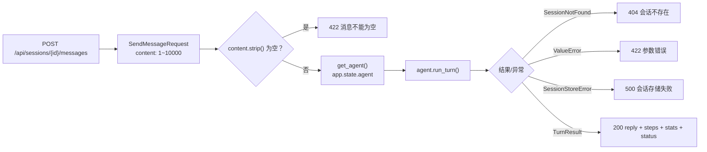

路由一览：

| 方法 | 路径 | 作用 |
| --- | --- | --- |
| `GET` | `/api/health` | 模型名、是否配置完整 |
| `POST` | `/api/sessions` | 创建 Session |
| `GET` | `/api/sessions` | 会话列表 |
| `GET` | `/api/sessions/{id}` | 消息、摘要、待办、统计 |
| `DELETE` | `/api/sessions/{id}` | 删除会话 + Trace |
| `POST` | `/api/sessions/{id}/messages` | 执行一轮 Agent |
| `GET` | `/api/sessions/{id}/traces` | 最近 Trace |

---

## 6. AgentLoop 主流程图

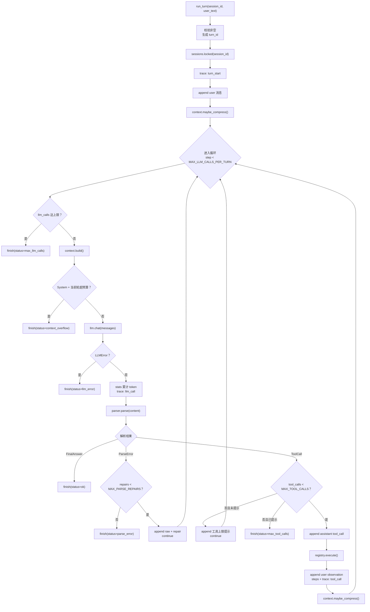

### 循环退出条件

| 条件 | `status` | 行为 |
| --- | --- | --- |
| 模型输出 `final` | `ok` | 保存 final，正常返回 |
| 工具次数达到 `MAX_TOOL_CALLS` | `max_tool_calls` | 先提示模型收尾；无视提示则兜底 |
| LLM 调用达到 `MAX_LLM_CALLS_PER_TURN` | `max_llm_calls` | 返回阶段性结果 |
| 协议纠错达到 `MAX_PARSE_REPAIRS` | `parse_error` | 返回格式异常提示 |
| LLM 不可用 | `llm_error` | 返回可读错误 |
| System + 当前用户消息超预算 | `context_overflow` | 不调用 LLM，提示缩短输入 |

---

## 7. 上下文构建

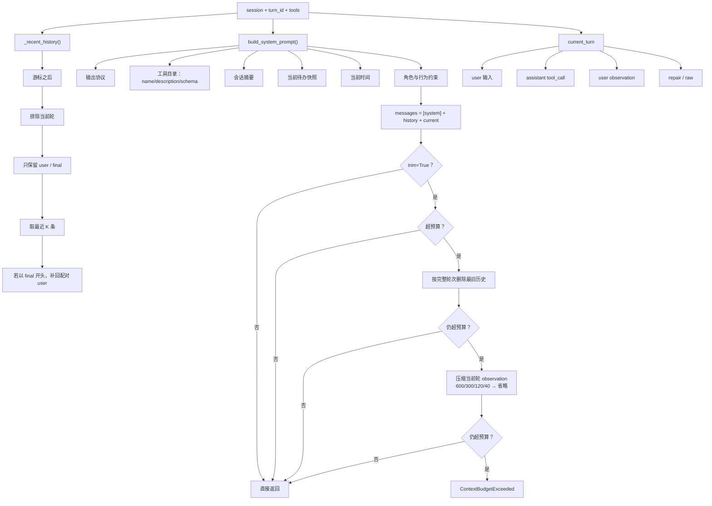

### 进入上下文的信息

| 信息 | 是否进入 | 位置 |
| --- | --- | --- |
| 用户输入 | 是 | messages |
| 当前轮 assistant 工具调用 | 是 | messages（原始 JSON） |
| 当前轮工具结果 | 是 | user observation |
| 最近 K 轮 user 原文 | 是 | messages |
| 最近 K 轮 final 回答 | 是 | messages |
| 历史 thought | 否 | 仅 Session / Trace / UI |
| 历史工具结果 | 否 | 仅 Session / Trace / UI |
| 会话摘要 | 是 | System Prompt |
| 待办快照 | 是 | System Prompt |
| 工具目录 | 是 | System Prompt |

---

## 8. 压缩流程

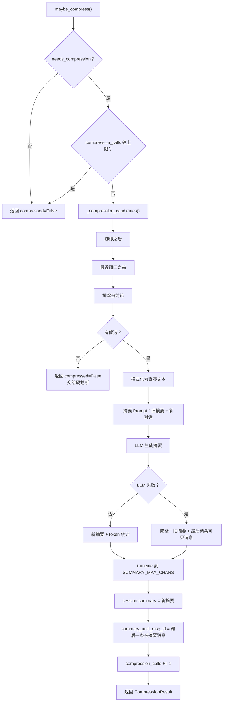

关键字段：

```json
{
  "summary": "用户要计算并记录待办；已完成 calculator 与 todo……",
  "summary_until_msg_id": "m_6",
  "stats": {
    "compression_calls": 1,
    "compression_prompt_tokens": 620,
    "compression_completion_tokens": 120
  }
}
```

游标只前进不后退，避免第二次压缩重复摘要。

---

## 9. LLM 调用

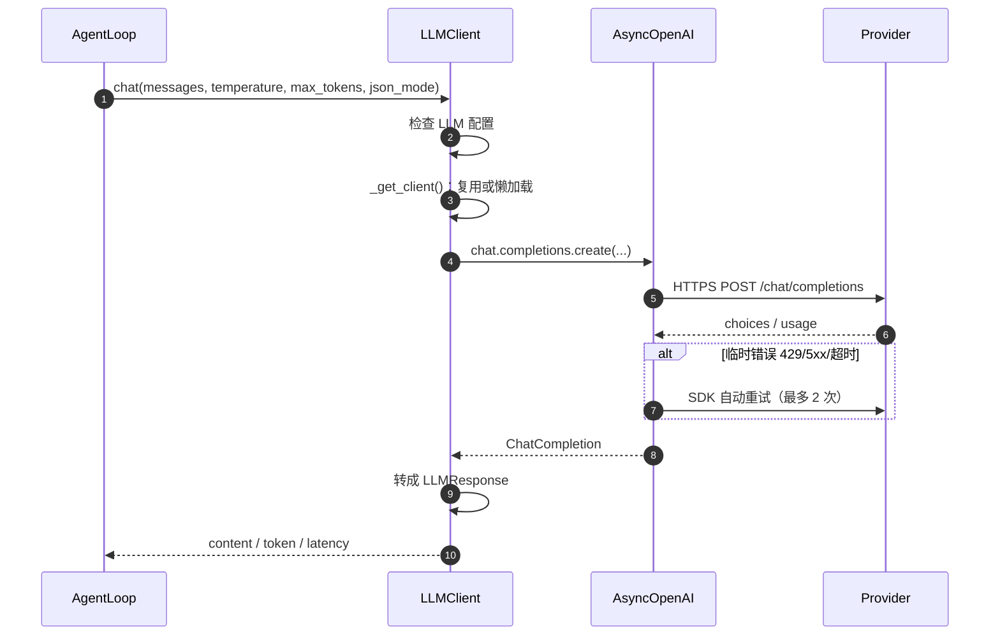

`LLMResponse`：

```python
LLMResponse(
    content='{"thought": "...", "action": "calculator", ...}',
    model="qwen3.8-max",
    prompt_tokens=1017,
    completion_tokens=231,
    finish_reason="stop",
    latency_ms=5464,
)
```

---

## 10. 协议解析

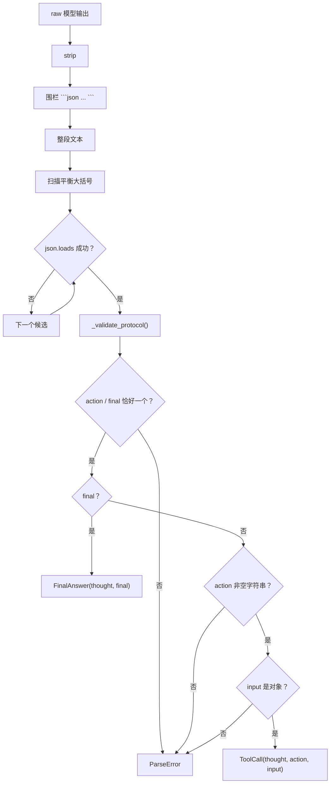

解析器兼容：

- 代码围栏；
- JSON 前后夹带说明文字；
- 嵌套对象；
- 字符串里的 `{}` 与转义引号；
- 多个候选对象，取第一个合法决策；
- 协议错误返回 `ParseError`，不抛到 API。

---

## 11. 工具执行

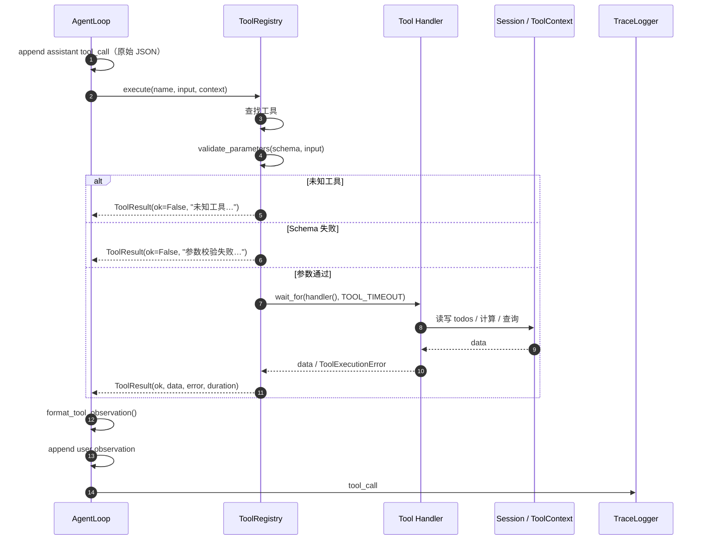

### 工具结果回填格式

```text
[工具执行结果]
tool: calculator
status: ok
input: {"expression": "2 ** 10"}
result: {"expression": "2 ** 10", "result": 1024}

请继续：需要更多信息就调用工具，否则输出 final。
```

失败时：

```text
[工具执行结果]
tool: todo
status: error
input: {"action": "complete", "id": "t_999"}
error: 待办不存在：'t_999'
请修正参数后重试，或向用户说明原因。
```

注意：使用 **user 角色**，不是缺少 `tool_call_id` 的 `role="tool"`。

---

## 12. 消息演化图

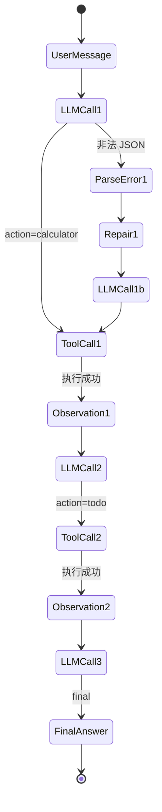

### 实际消息链

```text
┌─────────────────────────────────────────────────────────────┐
│ m_7  user                                                   │
│ 计算 2 的 10 次方，然后记一条待办：周五前提交周报。          │
├─────────────────────────────────────────────────────────────┤
│ m_8  assistant / tool_call                                  │
│ {"thought":"先计算...","action":"calculator",               │
│  "input":{"expression":"2 ** 10"}}                          │
├─────────────────────────────────────────────────────────────┤
│ m_9  user / tool_observation                               │
│ [工具执行结果] tool: calculator status: ok result: 1024     │
├─────────────────────────────────────────────────────────────┤
│ m_10 assistant / tool_call                                  │
│ {"thought":"记录待办","action":"todo",                       │
│  "input":{"action":"add","content":"周五前提交周报"}}        │
├─────────────────────────────────────────────────────────────┤
│ m_11 user / tool_observation                                │
│ [工具执行结果] tool: todo status: ok result: {"id":"t_1"}    │
├─────────────────────────────────────────────────────────────┤
│ m_12 assistant / final                                      │
│ 全部完成！2 的 10 次方 = 1024；待办已添加：周五前提交周报。  │
└─────────────────────────────────────────────────────────────┘
```

历史轮次进入上下文时只取 `user` 和 `final`；`tool_call` / `tool_observation` 只在当前轮使用。

---

## 13. 持久化与 Trace

### 13.1 Session 原子保存

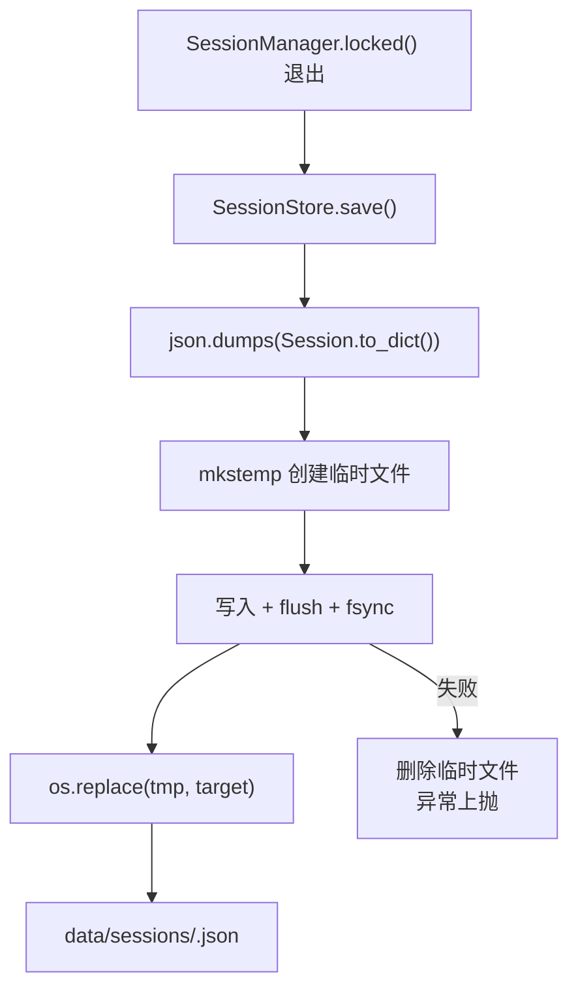

Session 文件结构：

```json
{
  "id": "s_...",
  "title": "计算 2 的 10 次方，然后记一条待办",
  "created_at": "...",
  "updated_at": "...",
  "summary": "",
  "summary_until_msg_id": null,
  "next_msg_seq": 13,
  "stats": {
    "llm_calls": 3,
    "tool_calls": 2,
    "compression_calls": 0,
    "prompt_tokens": 3639,
    "completion_tokens": 423,
    "compression_prompt_tokens": 0,
    "compression_completion_tokens": 0
  },
  "todos": [
    {"id": "t_1", "content": "周五前提交周报", "done": false, "created_at": "..."}
  ],
  "messages": []
}
```

### 13.2 Trace 事件时间线

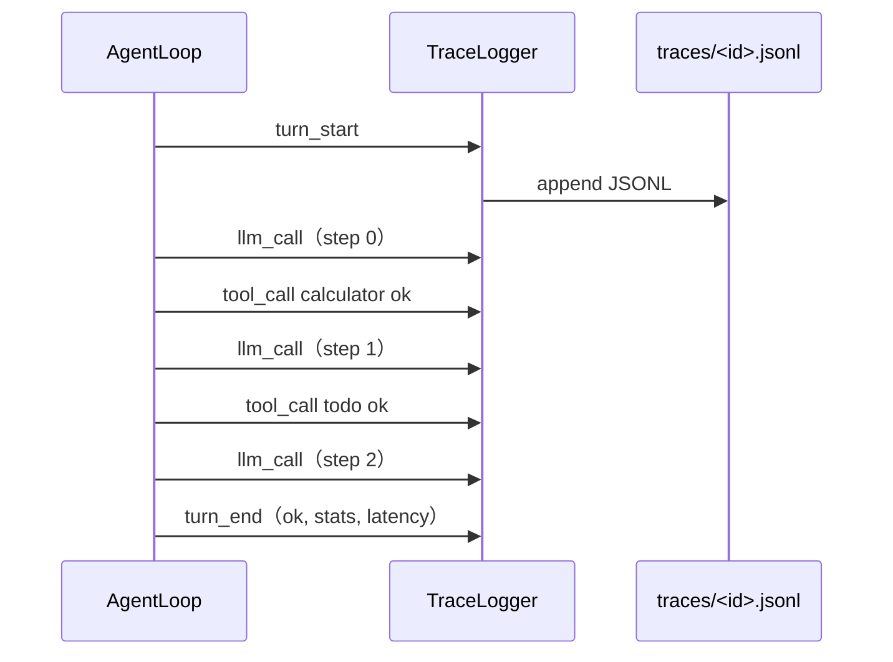

事件字段：

```json
{"event":"llm_call","step":0,"model":"qwen3.8-max","latency_ms":5464,"prompt_tokens":1017,"completion_tokens":231,"parsed":{"type":"tool_call","action":"calculator"}}
{"event":"tool_call","step":0,"tool":"calculator","status":"ok","duration_ms":2,"result_preview":"{\"result\":1024}"}
{"event":"compress","before_tokens_est":7200,"after_tokens_est":4100,"summarized_messages":6,"summary_until_msg_id":"m_12","fallback":false}
{"event":"turn_end","status":"ok","llm_calls":3,"tool_calls":2,"compression_calls":0,"latency_ms":1801}
```

Trace 失败只记日志，不中断 Agent；读取时损坏行跳过。

---

## 14. 返回与页面渲染

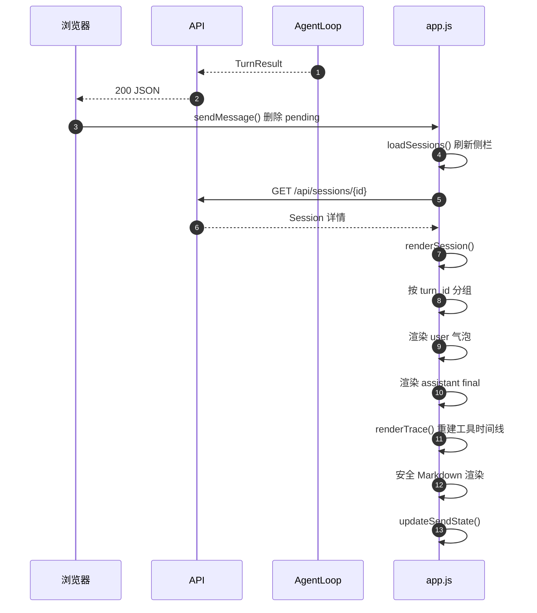

### 页面结构

```text
┌──────────────┬──────────────────────────────────────────────┐
│ Session 侧栏 │ Header：标题 / 轮数 / 待办数 / 模型           │
│              ├──────────────────────────────────────────────┤
│ 新建会话 ↗   │ 聊天区                                       │
│ 会话 A       │  ┌──────────────────────────────┐            │
│ 会话 B       │  │ user 气泡                    │            │
│ ...          │  └──────────────────────────────┘            │
│              │  ┌──────────────────────────────┐            │
│ 模型状态     │  │ Agent 回复                   │            │
│              │  │ ▸ 思考与工具调用 · 2 步      │            │
│              │  │   calculator / todo          │            │
│              │  └──────────────────────────────┘            │
│              ├──────────────────────────────────────────────┤
│              │ 输入框（Enter 发送 / Shift+Enter 换行）       │
└──────────────┴──────────────────────────────────────────────┘
```

### 刷新恢复

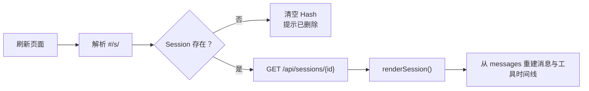

---

## 15. 异常与终止分支

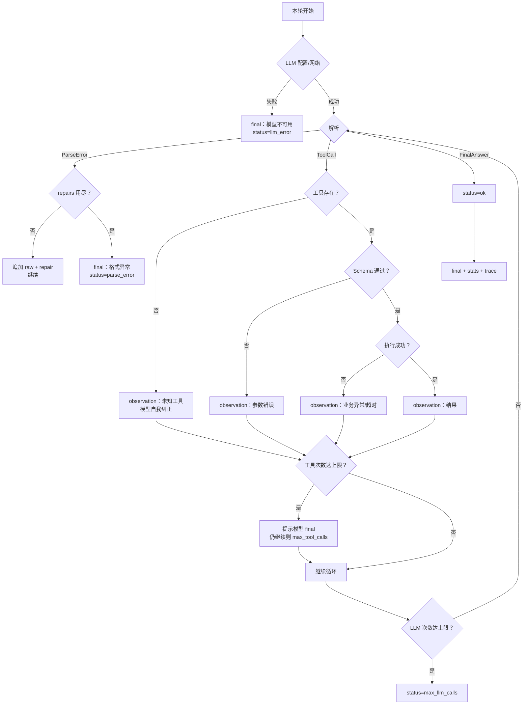

---

## 16. 并发模型

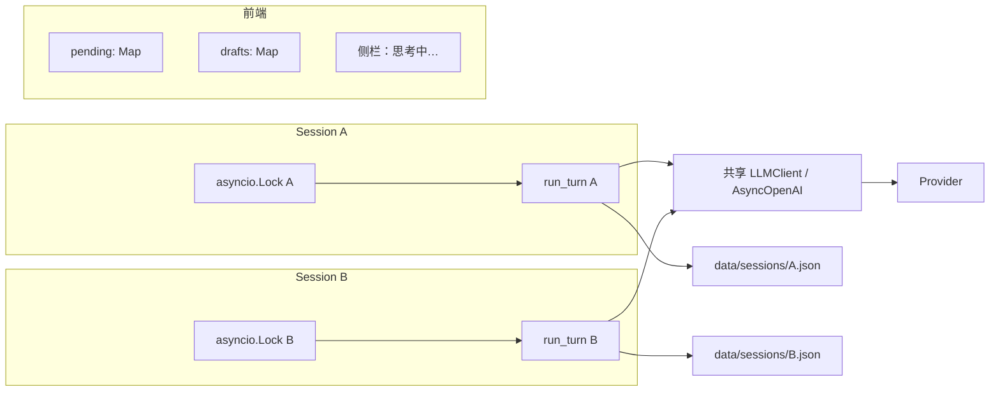

- 同一 Session 串行：避免并发写同一份 JSON。
- 不同 Session 并行：后端测试 `max_active == 2`；真实模型双请求 5.4 秒内一起完成。
- 前端 pending / draft 按 Session 隔离。
- 两个窗口绑定同一个 `#/s/<id>` 时共享会话，按设计串行；用「↗ 新窗口」获得独立 Session。

---

## 17. 真实运行示例

使用 `qwen3.8-max` 跑上面的示例任务，Trace 事件：

```text
turn_start
llm_call        step=0  latency=5464ms  tokens=1017/231  parsed=tool_call calculator
tool_call       step=0  calculator  ok  result=1024
llm_call        step=1  parsed=tool_call todo
tool_call       step=1  todo        ok  id=t_1
llm_call        step=2  parsed=final
turn_end        status=ok  llm_calls=3  tool_calls=2  prompt_tokens=3639  completion_tokens=423
```

最终 Session 统计：

```json
{
  "llm_calls": 3,
  "tool_calls": 2,
  "compression_calls": 0,
  "prompt_tokens": 3639,
  "completion_tokens": 423,
  "compression_prompt_tokens": 0,
  "compression_completion_tokens": 0
}
```

浏览器验证：

- 回复包含 `1024`；
- 时间线显示 2 步工具调用；
- 待办数为 1；
- 刷新后消息与时间线仍在；
- 第二个会话独立；
- A 思考中时 B 可发送。

---

## 18. 关键文件与函数索引

| 阶段 | 文件 | 关键函数 |
| --- | --- | --- |
| 启动装配 | `app/main.py` | `create_app()` / `lifespan` |
| 启动装配 | `app/agent/loop.py` | `build_agent_loop()` |
| HTTP 入口 | `app/api/routes.py` | `send_message()` / `get_agent()` |
| 浏览器发送 | `app/web/app.js` | `sendMessage()` / `api()` |
| 浏览器渲染 | `app/web/app.js` | `selectSession()` / `renderSession()` / `renderTrace()` |
| 核心循环 | `app/agent/loop.py` | `run_turn()` / `_finish()` |
| 上下文 | `app/agent/context.py` | `build()` / `maybe_compress()` / `compress()` |
| Prompt | `app/agent/prompt.py` | `build_system_prompt()` / `build_repair_message()` |
| LLM | `app/agent/llm.py` | `LLMClient.chat()` / `_parse_completion()` |
| 协议 | `app/agent/parser.py` | `parse()` / `_validate_protocol()` |
| 工具注册 | `app/tools/registry.py` | `ToolRegistry.execute()` |
| 工具 Schema | `app/tools/base.py` | `validate_parameters()` |
| 工具实现 | `app/tools/*.py` | `todo` / `calculator` / `search` / `weather` |
| 会话 | `app/session/manager.py` | `locked()` / `create()` / `delete()` |
| 存储 | `app/session/store.py` | `save()` / `load()` |
| Trace | `app/trace.py` | `log_llm_call()` / `log_tool_call()` / `log_turn_end()` |
| 测试 | `tests/agent/` | Loop / Context / Parser / Prompt |
| 测试 | `tests/session/` | 模型 / 存储 / 管理器 |
| 测试 | `tests/tools/` | Schema / Registry / 4 个工具 |
| 测试 | `tests/test_api.py` | FastAPI 路由 |
| 测试 | `tests/test_trace.py` | Trace 写入/读取/隔离 |

---

## 19. 一句话总结

```text
用户输入
  → FastAPI 校验
  → AgentLoop 会话锁 + 追加 user
  → 压缩检查
  → 循环：
      构建上下文
      → LLM
      → 解析
      → final / tool / repair
      → 工具结果以 user observation 回填
  → final
  → 统计 + Trace + 原子落盘
  → TurnResult
  → 浏览器重建消息与工具时间线
```

核心 Runtime（循环、协议、工具调度、Session、上下文、Trace）全部自研；FastAPI 与原生 Web UI 只负责传输和展示。
